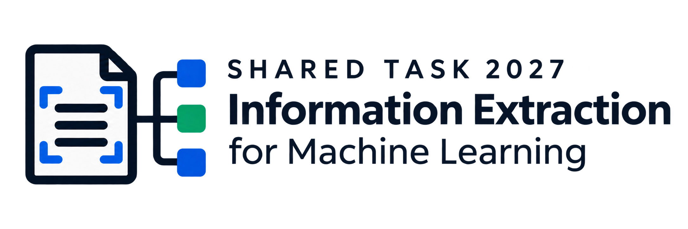

 

# IE4ML 2027 Shared Task on Information Extraction for Machine Learning

Reproducing machine learning (ML) research requires structured access to the models, datasets, methods, and relations described in scientific publications. IE4ML builds on (GSAP-ERE)[https://data.gesis.org/gsap/gsap-ere], an extension of (GSAP-NER)[https://data.gesis.org/gsap/gsap-ner], and turns its schema into a community benchmark for producing machine-actionable descriptions suitable for scholarly knowledge graphs and Web-scale discovery of knowledge about ML and AI Method usage. 

The Entity and Relation Extraction (ERE) task builds on 10 entity and 18 relation types describing ML-related information in full texts of scientific publications.

## Important Dates
* Dataset release: December 1, 2026  
* System submission deadline: January 4, 2027   
* Paper submission deadline: January 11, 2027  
* Notification of acceptance: February 8, 2027  
* Camera-ready deadline: February 16, 2027 

## Subtasks
For this shared task we defined two subtasks:
 * Named Entity Recognition (NER) of ML-Related Enitities
 * Joint Entity and Relation Extraction of ML-Related Entities

## Competion Platform
 * TBA

## Organizers
 * Wolf Otto (GESIS - Leibniz Institute for the Social Sciences, Cologne, Germany)
 * Hewan Shreshta (GESIS - Leibniz Institute for the Social Sciences, Cologne, Germany)
 * Lu Gan (GESIS - Leibniz Institute for the Social Sciences, Cologne, Germany)
 * Stefan Dietze (GESIS - Leibniz Institute for the Social Sciences, Cologne, Germany)

## Contact
 * wolfgang.otto@gesis.org

## References
 * GSAP-NER paper
 * GSAP-ERE paper
